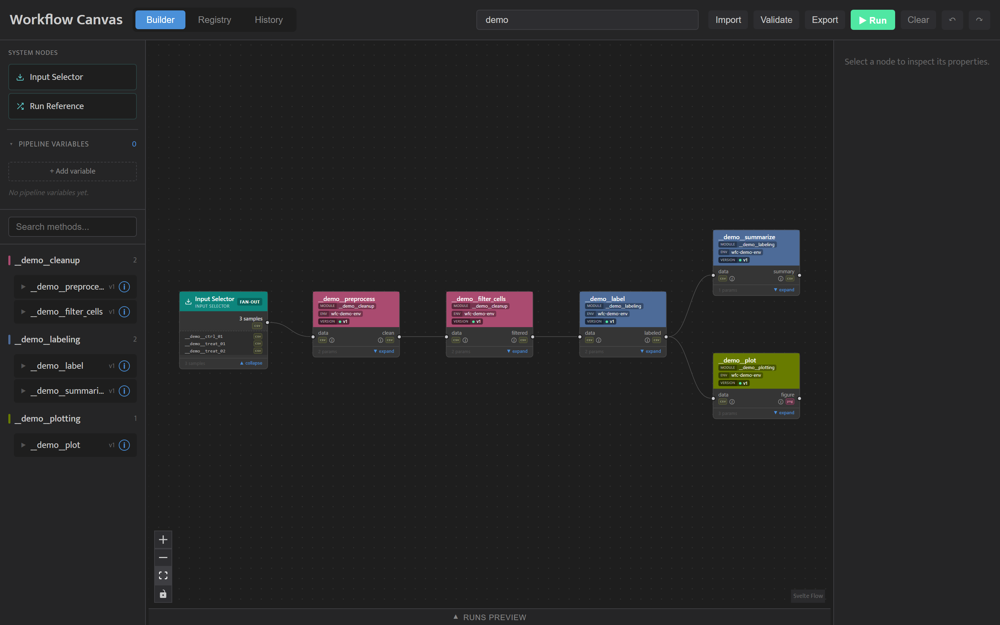

# Workflow Canvas

[](https://pypi.org/project/workflow-canvas/)
[](https://github.com/ddpoe/workflow-canvas/actions/workflows/ci.yml)
[](https://workflow-canvas.readthedocs.io/en/latest/)
[](LICENSE)

**A visual dry-lab notebook for reproducible analysis.**

Workflow Canvas (`wfc`) turns your analysis, in Python, R or bash, into a pipeline
you can see, and records the exact code, data, settings and software behind each
result, so anyone can rerun it and check that it matches.

Your AI agent can build the pipeline from your existing scripts and notebooks; you
can write it yourself, or mix the two. Either way, every result is reproducible.
Converting the example analysis in
[Convert an Analysis into a Pipeline](https://workflow-canvas.readthedocs.io/en/latest/tutorials/convert-an-analysis.html)
caught a filter that was computed but never applied.

For researchers, scientists and PhD students who want their analysis organized,
reproducible, and easy to pass on to others.



## Build it with an AI agent

The `wfc` plugin teaches Claude Code and Codex how Workflow Canvas works. Ask in
plain words to set up a project, turn one of your scripts into a pipeline step, run
it, or explain why a run failed. The agent tries each step on your data as a draft,
shows you every change it made, and registers nothing until you agree. What it
builds appears in the Canvas, with each step's settings and the results of every run.

In Claude Code (run each line in a terminal):

```bash
claude plugin marketplace add ddpoe/workflow-canvas
claude plugin install wfc@workflow-canvas
```

In Codex:

```bash
codex plugin marketplace add ddpoe/workflow-canvas
codex plugin add wfc@workflow-canvas
```

The plugin has three skills:

- `using-wfc`: working with wfc, from setting up a project to reading a failed run.
- `creating-a-wfc-method`: bringing one script in as a method.
- `converting-an-analysis-to-a-wfc-pipeline`: handing over a whole analysis, a
  folder of notebooks and scripts, and getting back a pipeline you approved step
  by step, with a record of every change.

Each is a plain folder under `plugins/wfc/skills/`, with a `SKILL.md`, that you can
copy into either tool's skills folder. For chats on claude.ai or ChatGPT, the desktop app and other
agents, see
[Work with an AI Agent](https://workflow-canvas.readthedocs.io/en/latest/tutorials/work-with-an-ai-agent.html).

Your agent sends what you type and the files it reads to its provider: see Anthropic's
[Data usage](https://code.claude.com/docs/en/data-usage) page or OpenAI's
[privacy policy](https://openai.com/policies/privacy-policy/).

## Key Features

| Feature | What it does |
|---|---|
| **AI agent plugin** | Skills for Claude Code and Codex that set up a project, turn your scripts or a whole analysis into pipeline steps, run them and explain failures. Nothing is registered until you agree. |
| **Drafts** | Run a step on your data as often as you like before registering it. Nothing a draft does is recorded. |
| **Rerun bundles** | Export any result, with its samples and every step that led to it, as one zip that reruns on another computer with Python and Docker and checks each output against yours. |
| **Core pipeline** | Register modules, methods, and samples; build a pipeline in the Canvas; generate and execute a Snakefile (`wfc run-pipeline`). |
| **Contracts** | Two-tier validation (module + method) declared in `method.yaml` — wiring errors and missing outputs are caught before a run starts. |
| **Caching** | A clean-git run gate plus a SHA-256 cache key over code, inputs, parameters, and the resolved container image — unchanged steps are skipped automatically; changing one method re-runs only what it touched. |
| **Lineage** | Every run is recorded in SQLite; trace any output back through its full DAG ancestry (cache hits appear as audit rows). |
| **Environments** | Methods run in containers built from a `pixi`, `conda`, or bring-your-own (`byo`) backend via `wfc register-env`; image digests are pinned in `.wfc/envs.json`. |
| **Parameter sweeps & fan-out** | Sweep parameters, fan out across variants and per-sample overrides, and reuse values with pipeline variables. |
| **Canvas** | A browser-based UI (`wfc canvas`) with three views: a drag-and-drop Builder, a run-History viewer with lineage and artifacts, and a Registry browser. |

## Under the hood

Workflow Canvas tracks your methods, their input/output contracts, run lineage, and
content-addressed caching in a local SQLite database, then compiles pipelines to
[Snakemake](https://snakemake.readthedocs.io/) Snakefiles so Snakemake handles
execution, parallelism, and dependency resolution. Every method runs inside a
container, and every output is stored in a content-addressed archive (DVC), so
results are reproducible and re-running an unchanged pipeline does no duplicate work.

## Requirements

- **Python 3.12** — required.
- **Docker** — required. Methods always run inside a container; nothing runs without a working Docker installation. `wfc init` pre-flights it and `wfc doctor` checks it.
- **Git** — required, but **local only**. wfc records a commit per run and refuses to run on uncommitted code. No GitHub account, login, or network is involved; wfc never pushes.

DVC and Snakemake ship with Workflow Canvas — you do not install them separately.

## Installation

```bash
# Installs the wfc CLI, plus bundled DVC and Snakemake
pip install workflow-canvas

# Verify
wfc --help
```

## Quick Start

New to Workflow Canvas? Start with the **Your First Pipeline** tutorial in the
[documentation](#documentation).

For the fastest first look, `wfc demo` populates a freshly initialized project
with a complete runnable example pipeline and opens it in the Canvas
(`wfc demo --remove` takes it back out):

```bash
wfc init --dir ./demo_project && cd demo_project && wfc demo
```

To have an agent do the setup instead, add the plugin
([Build it with an AI agent](#build-it-with-an-ai-agent)) and ask it:
`Set up a wfc project here.`

The steps below show the same setup done manually with your own code and data:

```bash
# 1. Initialize a project (guided wizard: scaffolds dirs, configures an output
#    archive, sets up a local git repo, and pre-flights Docker)
wfc init --dir ./my_project
cd my_project

# Optional: check that the project is ready to run (git, archive, Docker)
wfc doctor

# 2. Build and register the container environment your methods will run in.
#    Docs → "Register an Environment"
wfc register-env analysis conda:analysis

# 3. Register a module (from a module.yaml, recommended).
#    Docs → "Register a Module"
wfc register-module --name cell_analysis --module-dir src/cell_analysis

# 4. Register a method (reads the contract in its method.yaml and checks the
#    script against it).
#    Docs → "Write a Method in Python" and "Write a Method"
wfc register-method src/cell_analysis/preprocess --module cell_analysis

# 5. Register input data (content-hashed into the DVC store).
#    Docs → "Register Samples"
wfc register-sample --name CFPAC_ERKi --source /data/raw/cfpac_erki.csv

# 6. Build a pipeline in the Canvas and save it, then run the file.
#    Docs → "Run and Inspect Your Pipelines"
wfc run-pipeline --pipeline pipelines/my_pipeline.json --cores 4
```

## Visual Canvas

```bash
wfc canvas        # serves the UI at http://127.0.0.1:8500 by default
```

Use the **Builder** to assemble pipelines by dragging and wiring method nodes, the
**History** view to browse past runs (lineage chains, params, metrics, artifacts),
and the **Registry** to inspect everything registered in the project. See the
**Use the Canvas** how-to in the documentation for a walkthrough.

## Project Structure

A project is a local git repository. wfc keeps its config, its database and the
registered copy of each method in `.wfc/`, and the output files in an archive folder
outside the repository; your own method source lives wherever you keep it (for
example `src/`). Back up both `.wfc/` and the archive folder to keep results
recoverable.
[Project Anatomy](https://workflow-canvas.readthedocs.io/en/latest/explanation/project-anatomy.html)
maps every folder.

## Documentation

Full user documentation, with tutorials, how-to guides, the reference and
explanations, is published at
[workflow-canvas.readthedocs.io](https://workflow-canvas.readthedocs.io/en/latest/).

## Contributing

Bug reports, questions and pull requests are welcome. See
[CONTRIBUTING.md](CONTRIBUTING.md) for how to set up a development environment,
run the tests and build the docs, and the [Code of Conduct](CODE_OF_CONDUCT.md)
for how we work together.

## License

See [LICENSE](LICENSE).
