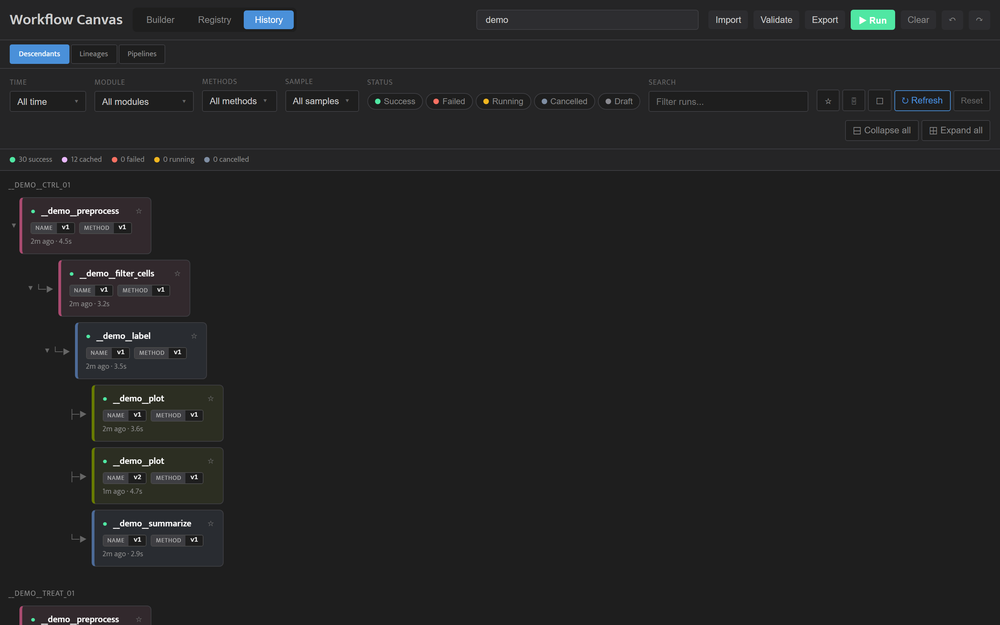
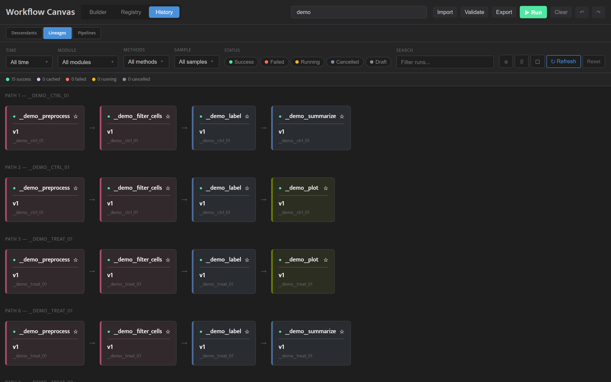
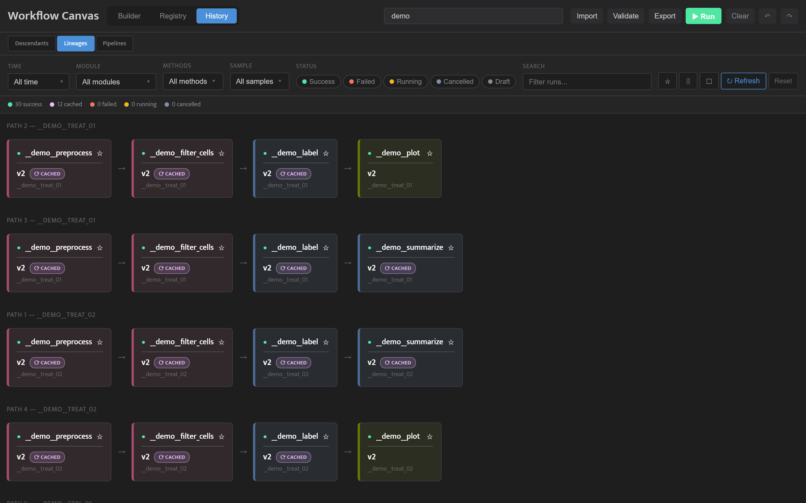
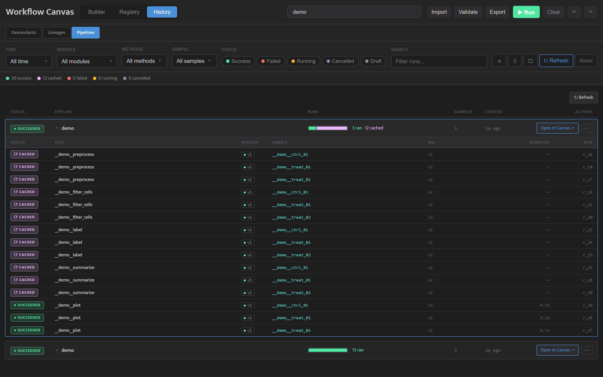

<!-- generated from pm_mvp::docs/consumer/how-to/browse-history @ b4b0f6caa2f1; do not edit -->

# Browse Past Runs in History

## The History Tab

The History tab shows the project's past runs, including runs started with `wfc run-pipeline`. A summary line counts the runs by status.

**Views.** Switch between three views at the top:

- **Descendants** (the default) -- per sample, a collapsible tree of the runs that actually executed. Runs served from the cache are left out, so after a re-run the tree shows only new work. **Collapse all** and **Expand all** sit at the end of the filter bar.
- **Lineages** -- one row per chain of runs, left to right from sample to final step. Runs served from the cache carry a `⟳ CACHED` pill, so a re-run gets its own row even when every step in it was reused.
- **Pipelines** -- one row per submitted pipeline, with its status, its runs and its samples. A pipeline is MIXED when some of its runs succeeded and others failed or were cancelled. The Runs column draws a small bar and counts the runs in words, for example `4 ran · 3 cached · 1 failed · 2 pending`: *ran* runs succeeded by running, *cached* reused an earlier result, and *pending* are runs the pipeline will still make. **Open in Canvas ↗** loads the pipeline onto the canvas; the **⋯** menu also downloads its pipeline JSON and copies its ID. While a pipeline is running, its row offers **Watch in Canvas ↗**, which shows it running on the canvas, and **Stop**. Click a row to list its runs by step and sample. Hover over a CANCELLED run to see why.

After a pipeline's first run, every step in the Lineages view has executed:

Change one parameter on the last step and run again, and only that step executes. Its new row shows the reused upstream steps marked `⟳ CACHED`, followed by the new run:

**Filters.** The filter bar applies to every view. Narrow the runs by time range (last 24 hours, 7 days or 30 days), module, methods, samples, status and free-text search. The buttons at the end of the bar show only favorites (★), show or hide archived runs (archived runs are hidden by default), turn on select mode for export, refresh, and reset the filters.

**Focus on one run.** Open a run and click **→ Descendants** in its detail panel to show only that run and the runs downstream of it; a banner names the run. **Show all runs** returns to the full view.

## From History Back to the Builder

Three actions load History into the Builder:

- **Open in Canvas ↗** on a row of the Pipelines view loads the pipeline as it was submitted, including its pipeline variables and bindings.
- **Open lineage in Canvas** in the detail panel rebuilds the run and every run upstream of it as a pipeline, each connection using the output and input slot the run actually used. Each node is pinned to the version that run used. Run it as-is to reuse its results, or change a parameter and run it as a new pipeline.
- **Reference in Canvas** in the detail panel adds a Run Reference node for the run to the current canvas and keeps everything already there, so a new pipeline can use its outputs as input. A message with **Jump to node** shows where it landed.

To keep the exact pipeline a run used, open the **⋯** menu on its row in the Pipelines view and choose **Download pipeline JSON**. The file has every method node pinned to the version it ran, so loading it later runs the same versions.

Both Open actions replace the canvas.
