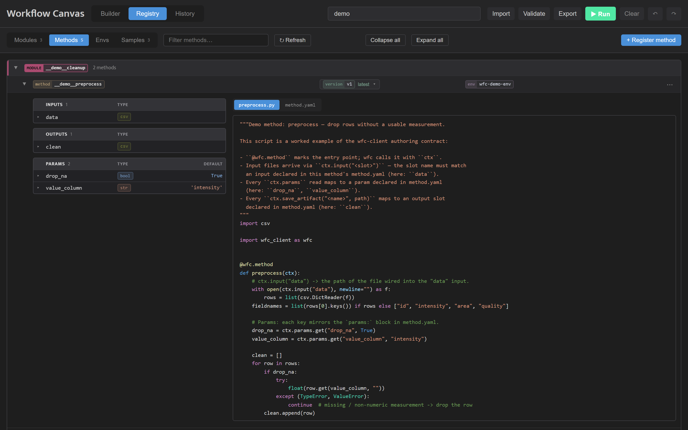

<!-- generated from pm_mvp::docs/consumer/how-to/browse-the-registry @ 655be22f1151; do not edit -->

# Browse and Register in the Registry

## The Registry Tab

The Registry tab lists everything registered in the project, on four sub-tabs. **↻ Refresh** reloads the lists and every open method.

- **Modules** -- each module with its output contracts and an `N methods →` link to its methods.
- **Methods** -- the methods grouped by module, each row showing the method, its newest version and its env. Click a module's name to fold it, or use **Collapse all** and **Expand all**. Click a method to open it: its inputs, outputs and parameters sit beside its files, the main script first, with syntax highlighting. Click an input, output or parameter to see its description.
  - An open method's row has a version picker in place of its version: pick an earlier version to see its files and contract. The newest is marked **latest**.
  - The **⋯** menu on a method's row has **Version details…** (when and from which commit it was registered, its runs and its env), **Copy version identity**, **Export script and contract** and **Register a new version…**. The **⋯** beside a version in the picker has the same for that version.
  - **Export script and contract** downloads the version as `<method>_v<N>.zip`, holding every file of its registered copy. Unzip it, edit it, and register the folder as the method's next version.
- **Envs** -- each registered environment with its backend, the methods that use it, its run count, and a chip saying whether its image has been pushed to the registry. Hover over the chip for the reason and the command that fixes it; see [Share a Project](sharing-a-project.md). Expand a pixi or conda environment to see its installed packages as `name==version`, tagged conda, pixi or pip.
- **Samples** -- each sample with its size, whether it has been pushed to the remote or is local-only, and how many runs used it.

On the Modules, Methods and Samples sub-tabs, **+ Register** opens a form to register a new one from the browser; see [Registering from the Canvas](#registering-from-the-canvas). Environments are registered from the command line; see [Register an Environment](../tutorials/registering-an-environment.md).

## Registering from the Canvas

You can also register modules, methods and samples in the canvas. Open the **Registry** tab, choose the **Modules**, **Methods** or **Samples** list, and click **+ Register**. The dialog has a switch for module, method or sample.

- **Module:** enter a name and an optional description. The module is registered with no contract; to add one, write a `module.yaml` and run `wfc register-module` again.
- **Sample:** enter a name and the absolute path to the source file.

For a module or a sample, click **Dry run** to run the same checks as registration without saving anything; each check is listed as passed, warning or failed. Click **Register** to save it. If the server refuses, the error appears in the dialog and nothing is saved.

### A method

The Method form starts with a choice: **New method** or **New method version**.

- **New method:** enter the method's folder, or click **Browse…** to pick it from the project, and choose the module. The method name is optional and defaults to the folder's name. If the module already has a method of that name, the form says so and offers **Register a new version instead**.
- **New method version:** choose the module, then the method, then the folder. Once the method is chosen the form shows its current version and the one this registration adds. **Register a new version…** in a method's **⋯** menu opens this form with the module and method already chosen.

Click **Register method** (or **Register version**) to check the folder. The check runs the same rules as `wfc register-method` and saves nothing:

- If the folder cannot be registered, each problem is shown in red with what wfc expects, for example the `script:` line to add to `method.yaml`. Fix the folder and click **Check again**.
- If it can, the dialog shows what the new version holds: what changed since the newest version (code files, inputs and outputs, parameters, env), each with its count and a before-and-after table, then the version's main script, its helpers and the files it leaves out. A new method lists everything it registers. Click **Confirm: register vN** to save exactly what was checked.
- If the folder holds the same content as the newest version, the dialog says **nothing to register**.

**← Back** returns to the form, and **Cancel** closes the dialog.
