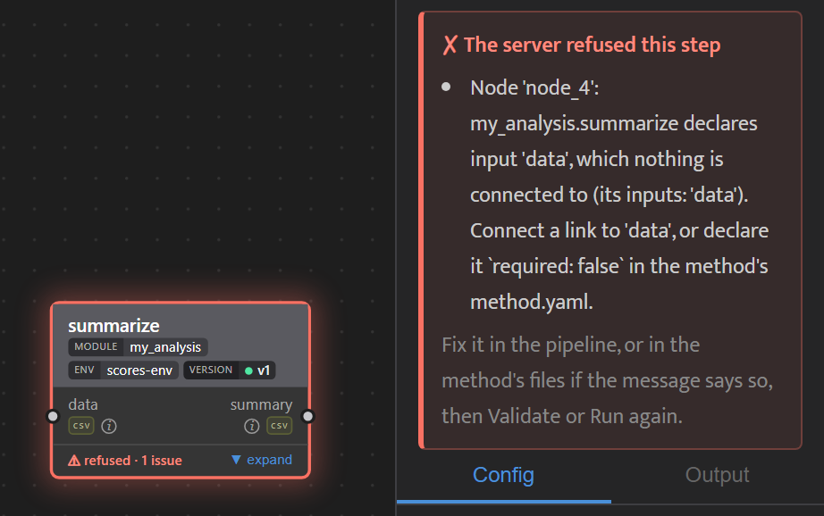
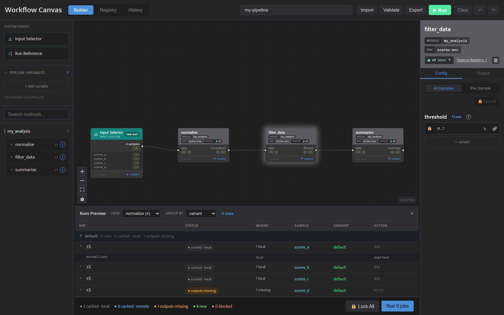
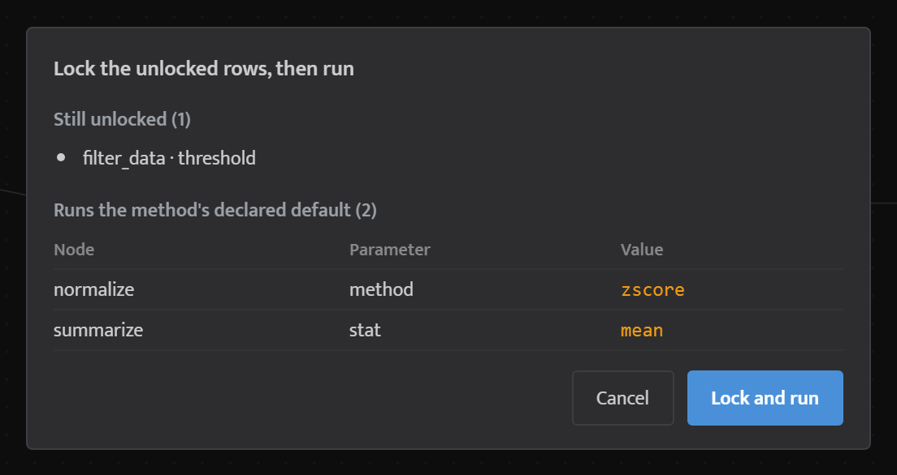
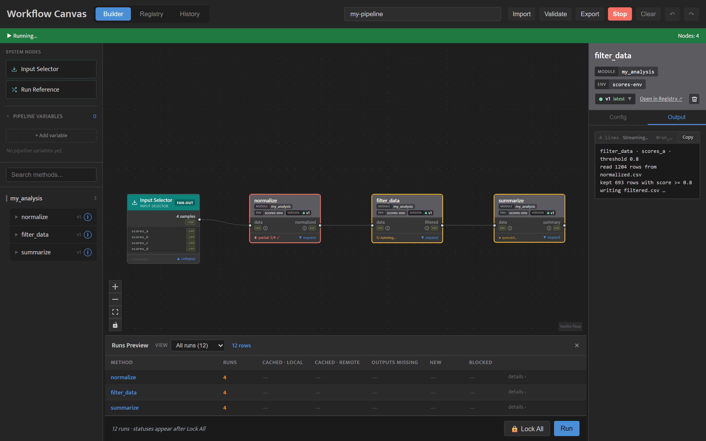

<!-- generated from pm_mvp::docs/consumer/how-to/check-and-run @ d2c435c8a61c; do not edit -->

# Check and Run a Pipeline

## Name and Validate

**Name the pipeline** in the text field in the toolbar. The name titles the pipeline's row in History's Pipelines view.

**Validate** checks the graph against the registered methods and lists any problems, such as an unknown method or a method node with nothing feeding it. A valid graph shows "Workflow is valid!".

## A Refused Node

When Validate or Run refuses a node, it gets a red border, its footer reads **⚠ refused** with the number of issues, and the Inspector lists the reasons. The mark stays until the next Validate or Run. What a check refuses is in [When contracts are checked](write-a-method.md#when-contracts-are-checked); a draft's own marks are in [Draft in the Canvas](draft-in-the-canvas.md).

A refusal that names no node, and a problem that stops any run, such as uncommitted changes in the repository or Docker not running, appear in a banner over the canvas. Close it with ×.

## Preview the Runs

**The Runs Preview** at the bottom of the Builder lists every run the pipeline will schedule. The **All runs** view has one row per method node with its run count; pick a node to see its runs, one per sample and variant, with the parameters each will use. Those rows can be grouped by sample, variant or status. A row that would produce exactly the same result as an earlier row is counted but hidden behind a **Show N reused** toggle. Close the table with × and reopen it from the **Runs Preview** tab at the bottom edge.

Until you lock, the preview shows run counts only. Click **🔒 Lock All** to lock every parameter row and ask the project which runs are already done. Each row then shows one status:

| Status | What happens on Run |
|---|---|
| `cached · local` | skipped; the earlier result is reused |
| `cached · remote` | skipped; the earlier result is pulled from the remote |
| `outputs missing` | re-run, because the earlier run's outputs are gone |
| `new · this step changed` | runs |
| `new · upstream re-runs` | runs, because a step feeding it runs |
| `blocked` | cannot run; the row gives the reason |

A cached row links to the run it reuses. Any edit clears the statuses until you lock again. While a row is blocked, **Run** is disabled and its tooltip lists the reasons. For why a step is reused or re-run, see [Caching & Reproducibility](../explanation/caching-and-reproducibility.md).

## Run the Pipeline

**Run** starts the pipeline. If any parameter row is still unlocked, Run first opens a summary listing those rows and every parameter that will run with its declared default; click **Lock and run** to go ahead. If a row cannot be locked, the summary names it and the run does not start.

## While It Runs

While the pipeline runs, **Run** becomes **Stop**, and each node shows its status, such as running, queued, completed, failed or cached, or a count such as **partial 3/4 ✓** when some of its samples failed. Select a node and open the Inspector's **Output** tab to follow its log. A cached node names the run it reused, and a node cancelled by an upstream failure names the step whose failure stopped it.

If a pipeline is interrupted, a badge in the toolbar counts the runs whose outputs are not yet archived; click it and choose **Archive now**.

## Import and Export

**Export** downloads the canvas as a pipeline JSON file named after the pipeline, which you can run with `wfc run-pipeline` (see [Use the Command Line](cli-hub.md)). **Import** loads a pipeline JSON file and replaces the canvas.
