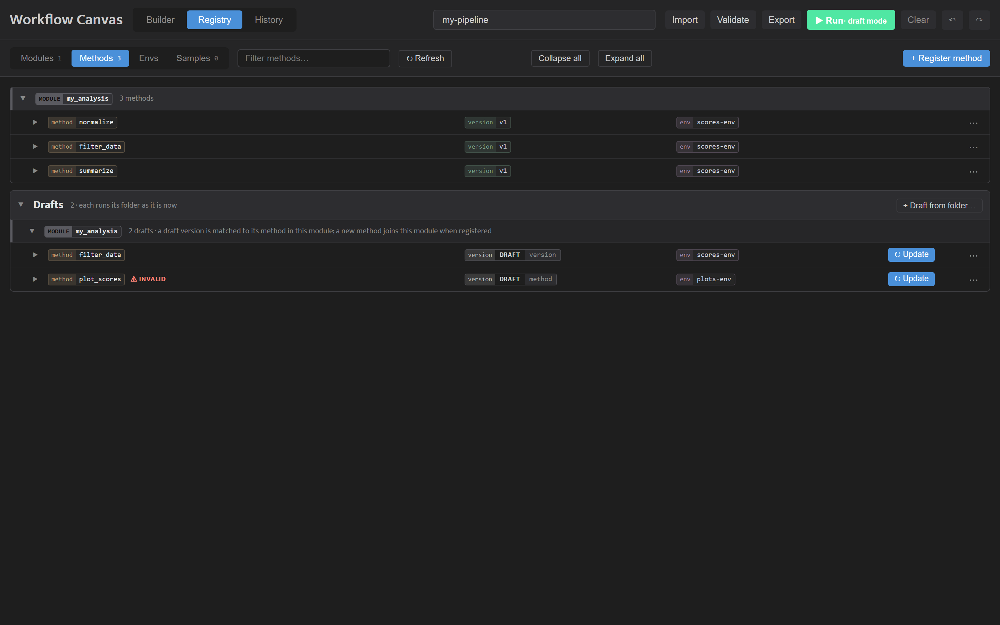
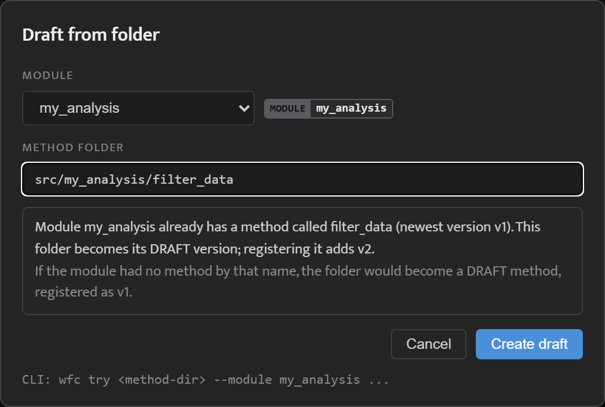
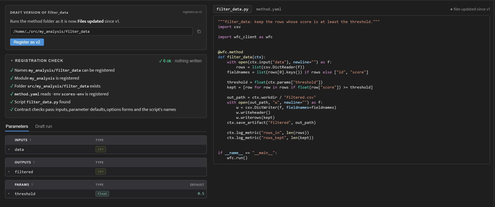
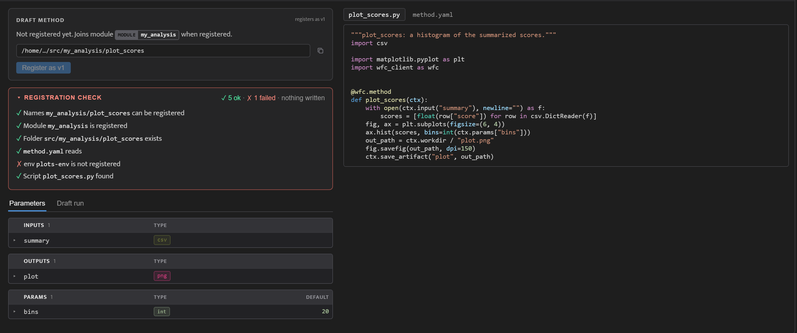
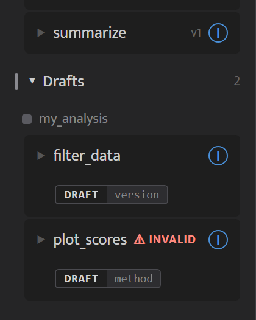
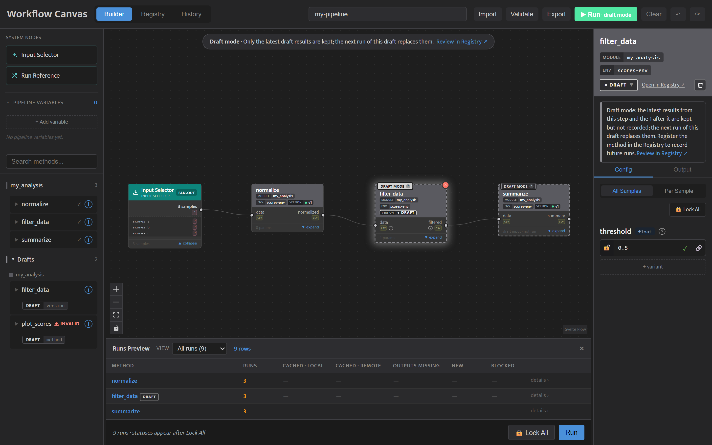
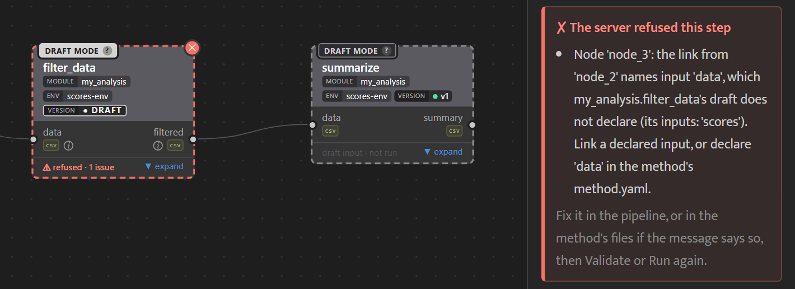
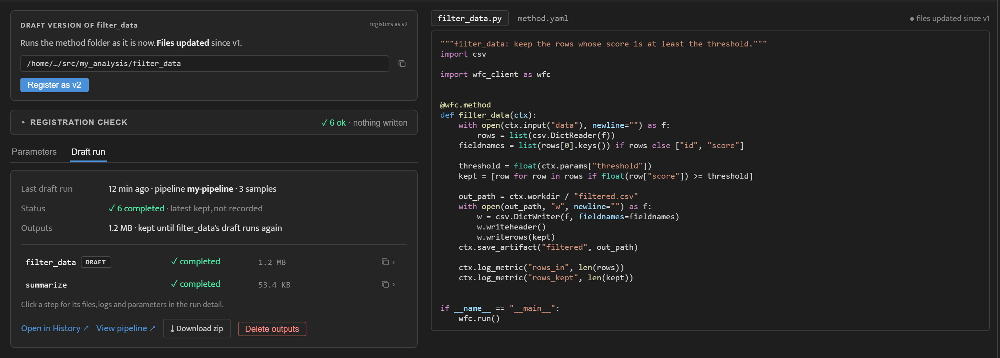
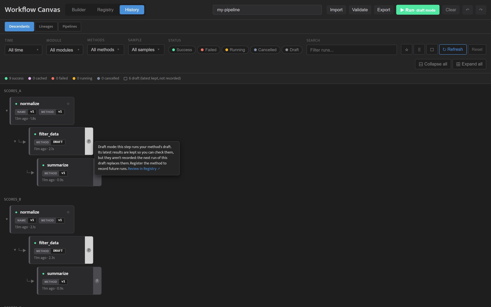

<!-- generated from pm_mvp::docs/consumer/how-to/draft-in-the-canvas @ 0487280d0770; do not edit -->

# Draft in the Canvas

## Overview

In the canvas a draft sits next to the registered methods: you can check it, run it in a pipeline and register it from the browser. How drafts work is on [Draft a Method](../tutorials/drafting-a-method.md); the same steps from the command line are on [Draft from the Command Line](draft-from-the-command-line.md).

Start the canvas from your project root with `wfc canvas`.

## Find Your Drafts

Open **Registry**, then **Methods**. The **Drafts** group at the end of the list holds every draft, by module, including the ones `wfc try` made. Each row's version chip says whether it is a draft version of a method the module has or a new draft method, and a draft that fails its checks is marked **⚠ invalid**.

## Make a Draft from a Folder

Press **+ Draft from folder…** in the **Drafts** group, choose the module, and type the method folder's path, for example `src/my_analysis/filter_data`. Before you press **Create draft**, the dialog says what the folder becomes: a new method, or the next version of a method the module already has.

## Read the Draft's Panel

Click a draft to open its panel:

- The card says what the draft is, such as **DRAFT VERSION OF filter_data**, which version registering adds, and whether its files changed since the newest version.
- **Registration check** runs the checks registering makes, one line each, and writes nothing.
- The folder's files, `method.yaml` and the script, are on the right, as they are on disk now.
- **Parameters** shows the inputs, outputs and parameters the draft declares; **Draft run** shows its last run (see [Look at the Results](#look-at-the-results)).
- **↻ Update** on the draft's row reads `method.yaml` again without running anything.
- **Remove draft**, in the row's **⋯** menu, deletes the draft and its results, but not your method folder. It shows what it will delete before you confirm.

## When a Draft Fails Its Checks

A draft whose folder fails the registration checks stays in the list, marked **⚠ invalid**. Its Registration check marks each failure with ✗ and says what is wrong, and its register button stays off until every check passes. In a pipeline its node shows **⚠ invalid** too, with the reason on hover. Fix the folder, then press **↻ Update** or run the pipeline again. What the checks are is in [When a Draft Cannot Run](../tutorials/drafting-a-method.md#when-a-draft-cannot-run).

## Put the Draft in a Pipeline

In the **Builder**, the palette has a **Drafts** group after the modules. Drag a draft onto the canvas and wire it like any method. For a method that is already registered, you can instead pick **● DRAFT** as a node's version in the Inspector.

The pipeline is now in Draft mode: the draft's node and every node after it are marked **DRAFT MODE**, and the Inspector on the draft says how many steps run as drafts, with **Review in Registry ↗** to open the draft. What Draft mode runs is on [Draft a Method](../tutorials/drafting-a-method.md#draft-mode-in-a-pipeline).

## When the Pipeline No Longer Fits the Draft

If an edit to the draft's `method.yaml` means the pipeline no longer fits it, for example an input the pipeline wires is renamed, **Validate** or **Run** refuses the node like any other ([A Refused Node](check-and-run.md#a-refused-node)), and the message names the input or parameter that no longer fits. Edit the pipeline to match, or change the draft's folder.

## Look at the Results

Run the pipeline. The **Draft run** tab on the draft's panel shows its last run: when it ran and in which pipeline, its status, the size of its outputs, and each step, with a button that copies the names of its draft steps, which `wfc export --run` takes. **Open in History ↗** shows the steps in History, **⤓ Download zip** downloads the outputs, and **Delete outputs** removes them and keeps the draft.

In **History**, the draft's steps are listed beside the recorded runs and marked **DRAFT**; steps after the draft carry a strip at their right edge whose **?** explains that they used the draft's results. Click a step for its files, logs and parameters.

## Register It

When the results are right, press **Register as v2** on the draft's panel (**Register as v1** for a new method). It shows what registering will do, and **Confirm: register v2** registers it and removes the draft. From then on the method's runs are recorded and cached.
