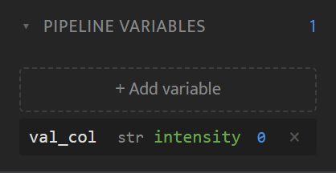
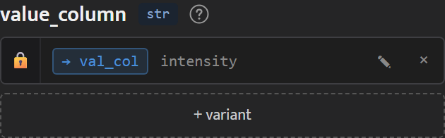

<!-- generated from pm_mvp::docs/consumer/how-to/pipeline-variables @ 7e3a028346f0; do not edit -->

# Share a Value with Pipeline Variables

## Pipeline Variables

A pipeline variable is a named value you set once and bind to parameters on several nodes, for example a label column that several methods use.

**Create a variable.** Open the **Pipeline Variables** panel in the palette (below the system nodes) and click **+ Add variable**. Enter a name, pick a type (`str`, `int`, `float`, `bool`, `list` or `dict`), enter a value and click ✓. A value the type does not accept is reported in the panel and the variable is not added. Each variable's row shows its type, its value and how many parameter rows are bound to it. Click × to delete a variable; if rows are bound to it, Canvas asks you to confirm first.

**Bind a parameter.** In the Inspector, click 🔗 on a parameter row and choose a variable. Variables of a type the parameter cannot take are greyed out. The row then shows `→ name` and the variable's value.

**Unbind.** Click × on a bound row to unbind it, or ✎ to unbind it and start editing a literal value straight away.

When the pipeline runs, every bound parameter receives its variable's value. The exported pipeline JSON keeps the variables and bindings, so it runs the same way with `wfc run-pipeline`, and **Open in Canvas ↗** in History's Pipelines view brings them back with their bindings.
