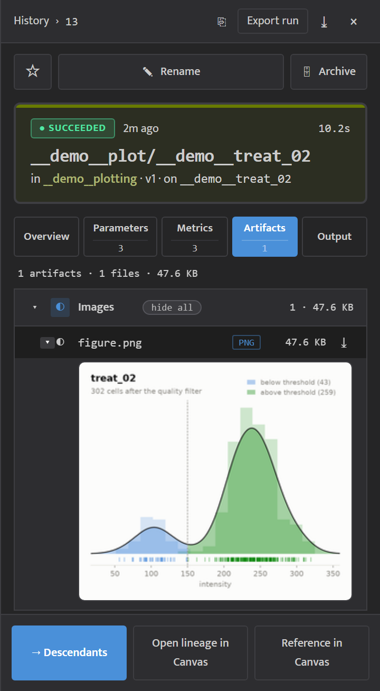
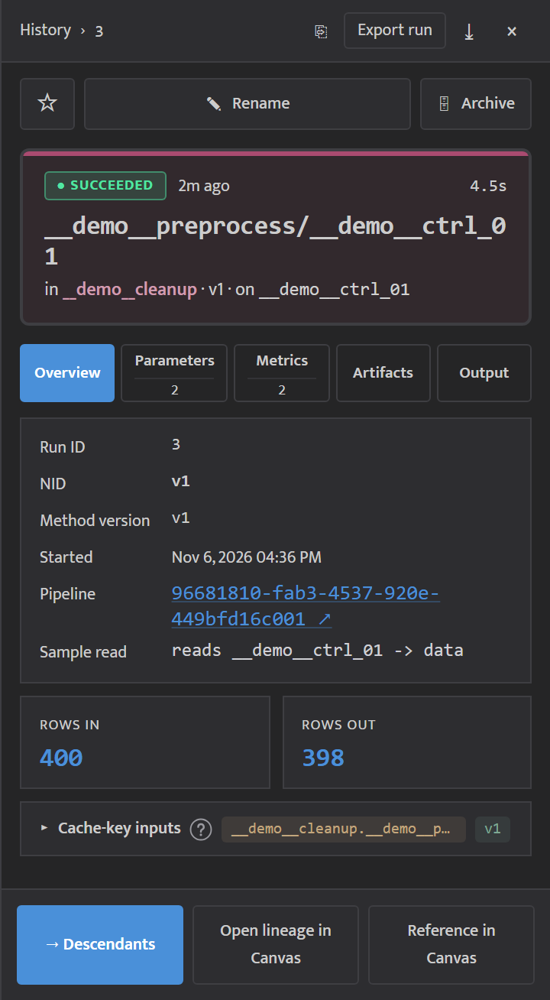
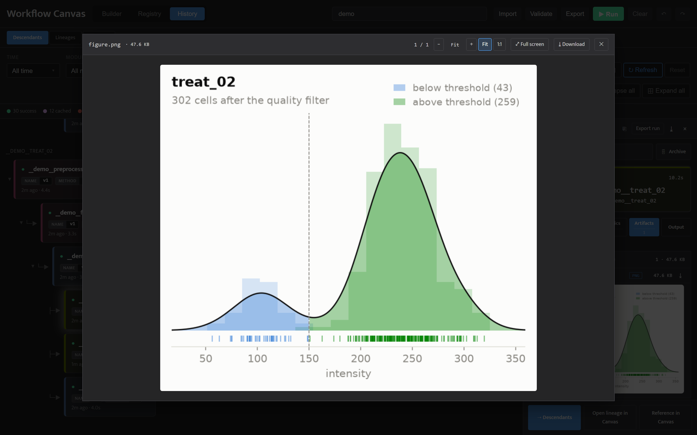
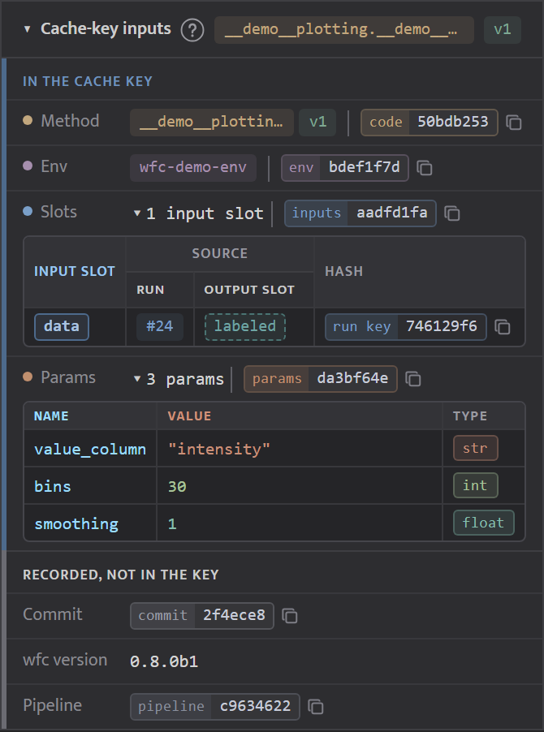
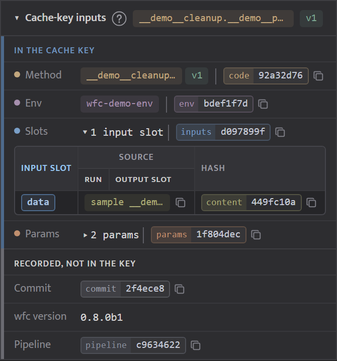

<!-- generated from pm_mvp::docs/consumer/how-to/run-details @ 7f1f4bc3ca27; do not edit -->

# Look at a Run's Results

## Run Details and Downloads

Click a run in any view to open its detail panel. From its header you can copy the run ID (which `wfc export` takes) or a share link, download the run's record as JSON, star it as a favorite, rename it, or archive it to hide it from the default list (**Unarchive** brings it back). A failed run shows its error at the top of the panel, on every tab, with **See output** to open its log. The panel has five tabs:

- **Overview** -- run ID, start time, the pipeline it belongs to, its parent runs by input slot, and each sample it read as a line "reads *sample* → *slot*". A cached run shows **Cached from** with a link to the run it reused. A cancelled run says why it was cancelled: you stopped it, an upstream step failed (naming that step and sample, with a link to the failed run), or the pipeline ended before it started. A failed run lists the runs cancelled because of it. The tab ends with the **Cache-key inputs** card, which shows what decided whether wfc could reuse this run (see below).
- **Parameters** -- the values it ran with.
- **Metrics** -- the numbers the method logged.
- **Artifacts** -- the output files, grouped by kind under headers you can collapse. Image previews start closed: click the arrow beside an image to show its preview, or **show all** on a header or folder to show every preview there (**hide all** closes them). Click a file's name or its preview to open it in the viewer (below); the download icon always downloads it. A file the viewer cannot show can only be downloaded. A cached run lists the outputs of the run it reused. An output that changed after the run wrote it is listed first under **Unavailable**, with "changed after the run wrote it; run the step again" and no download link.
- **Output** -- the run's log, marked ✗ when the run failed. **Load full log** shows all of it, and **Copy** copies the lines shown.

**Look at an output in the viewer.** The viewer opens over the canvas on the file you clicked. Step to the other files of the same folder (or of the top level) with ‹ and ›, the left and right arrow keys, or the strip of small previews along the bottom; files the viewer cannot show are skipped. **Download** saves the file you are looking at, and Esc closes the viewer.

- **Images** open fitted to the window. Zoom with − and + or the mouse wheel, and drag to move around. **1:1** shows the image at full size and **Fit** fits it again. **Full screen** fills the screen. A large image is shown as a smaller preview, with a note under it saying how it differs from the file. Download the file for the full image.
- **Tables** show their first 100 rows. **Delimiter** and **Header row** change how the file is split; Auto shows what it guessed.
- **JSON** opens as a tree you can expand; **Raw** shows the text.
- **Text** shows line numbers, and **Wrap** wraps long lines.
- **PDFs** open in the browser's own PDF viewer, with **Full screen**.

An image too large to preview shows "Too large to preview". Download it, or raise the preview memory limit; see [wf-canvas.toml](../reference/wf-canvas-toml.md).

**Make the panel wider.** Drag the run panel's left edge to make it wider or narrower. Double-click the edge to reset it.

**See why a run was or was not reused.** The last block of the Overview tab is the **Cache-key inputs** card. Click its title to open it; click **?** for a short explanation of the cache key. *In the cache key* lists what wfc compared:

- **Method**: the method, its version and its `code` hash.
- **Env**: the environment and its `env` hash.
- **Slots**: click *N input slots* for a table of each input slot and what filled it: an upstream run and its output slot with that run's `run key`, or a sample with its `content` hash.
- **Params**: click *N params* for a table of each parameter's name, value and declared type. Hover over a long value to preview it; click it to open its full JSON.

Two runs with the same key have the same rows. *Recorded, not in the key* lists where the run came from: the `commit`, the wfc version and the `pipeline` hash.

Each run, output, method, sample and pipeline on the card links to its own page.

**Export a run to rerun elsewhere.** **Export run** in the detail panel's header packages the run and every run above it, with the samples they read, as a zip: a record of how the result was made that anyone with Python and Docker can rerun with `python rerun.py`, without wfc, checking each output against yours. **Export runs** does the same for the runs you selected (see below). The dialog shows how many steps the bundle holds, or every reason it cannot be made. **Include outputs** adds the original output files so the receiver can compare them with the rerun's; **Include images** adds each step's container image. If a step's image was never pushed to a registry and **Include images** is off, the dialog warns about it and the button reads **Export anyway**. The command-line equivalent is `wfc export-run`; see [Share Runs as a Bundle Anyone Can Rerun](share-bundle.md).

**Download several runs at once.** Click the select-mode button in the filter bar and tick the runs you want, then click **Export Artifacts** in the bar that appears. A preview shows what will be downloaded and its total size. Click **Download Zip** to download them as one zip file.
