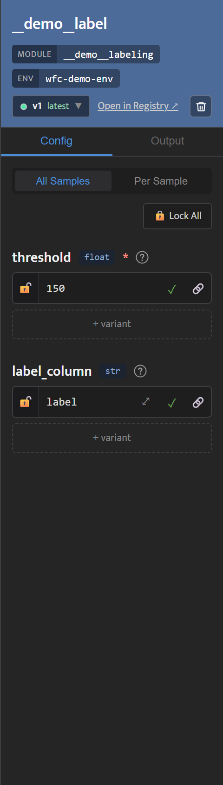
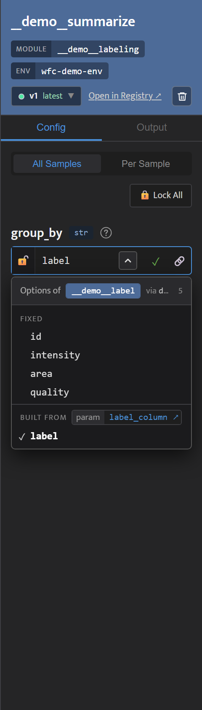

<!-- generated from pm_mvp::docs/consumer/how-to/set-parameters @ 217b2ab75eab; do not edit -->

# Set Parameters

## Setting Parameters

Click a method node to open it in the Inspector. The header shows the method name, its module and env, and the version the node runs: **latest**, **pinned** or **DRAFT**. The **Config** tab lists the node's parameters, each with its type next to its name. Required parameters are marked `*`; hover the `?` for a parameter's description.

**Edit a value.** Each parameter row is locked (🔒) until you edit it. Click ✎ to unlock the row, change the value, and press Enter or click ✓ to lock it in. The control matches the parameter's type: a toggle for booleans, a dropdown for a fixed set of choices, a number box for `int` and `float`, a text box for strings (⤢ expands it to several lines, where Ctrl+Enter locks the value in), and JSON for `list` and `dict`. If the type does not accept a value, the row says why and stays unlocked. Some text parameters offer a list of names from the upstream step, such as its column names. Click the chevron to pick one, or type any value. See [Let Users Pick Columns in the Canvas](pick-columns-in-the-canvas.md).

A parameter you never set runs with the method's declared default.

**Lock All** at the top of the parameter list locks every unlocked row on the node; it works like **Lock All** in the Runs Preview (see [Check and Run a Pipeline](check-and-run.md)).

To try several values for a parameter, or give one sample its own values, see [Sweep Values and Override Samples](sweep-values.md). To share one value across many rows, see [Share a Value with Pipeline Variables](pipeline-variables.md).

The **Output** tab shows the log of this node's most recent run. When a step fails, a **This step failed** box shows its error and a **See output** button that opens the log.
