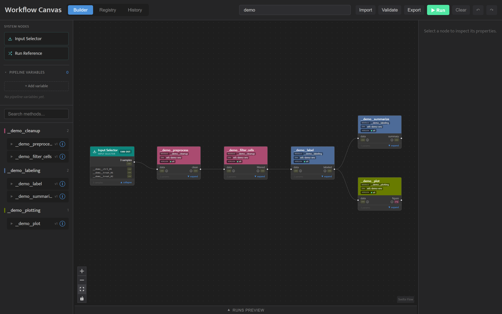

<!-- generated from pm_mvp::docs/consumer/how-to/wire-a-pipeline @ 2cb521ce4b33; do not edit -->

# Wire a Pipeline

## Building a Pipeline

The Builder has a palette on the left, the canvas in the middle, the Inspector on the right and the **Runs Preview** table along the bottom.



**The palette.** At the top are the two system nodes, **Input Selector** and **Run Reference** (see System Nodes below), then the Pipeline Variables panel, then every registered method grouped by module. Type in **Search methods...** to filter by method or module name. Click a method to expand its input and output slots (fan-in inputs are marked `MULTI`); the **i** button shows its description and parameters.

**Add a node.** Drag a system node or a method from the palette onto the canvas. A method node shows its input slots on the left and its output slots on the right, each labelled with its file type (`csv`, `h5ad`, `dir`, ...) and coloured by that type, so slots of the same type share a colour.

**Choose a version.** A method node follows the newest registered version of its method, and its header shows the version number it runs on, with a green dot while that is the newest and a yellow dot when the node is pinned to an older one; hover the number to see which. To run an older version, select the node and pick it from the version dropdown in the Inspector (`v1`, `v2`, ...); the node pins that version, draws that version's inputs, outputs and parameters, and keeps its cached results when a newer version is registered. Picking the newest again makes the node follow it.

**Connect nodes.** Drag from an output slot to an input slot. An input slot takes one connection.

**Delete and undo.** Select a node and press Backspace, right-click it and choose **Delete Node**, or use the delete button on the node or in the Inspector. Hover over a connection to delete it. **Ctrl+Z** undoes and **Ctrl+Y** (or **Ctrl+Shift+Z**) redoes; the toolbar has matching buttons. **Clear** empties the canvas.


## System Nodes

A pipeline's data comes in through **system nodes**. Every method node needs something connected upstream of it, so each chain starts at a system node; Validate reports a method node with nothing feeding it.

**Input Selector** feeds registered samples into the pipeline. Select the node, pick samples on the **Select Inputs** tab and click **Accept Selection**. The **Settings** tab sets the node's label and whether the samples fan out (one run per sample, the default) or fan in (one run for all of them); see [Fan Out and Fan In](fan-out-and-fan-in.md).

**Run Reference** feeds an output of a finished run into the pipeline, so you can build on earlier results without re-running them. Select the node, choose a completed run on the **Select Run** tab (expand a run to see its parameters and outputs) and click **Accept Selected Run**. The **Output** tab sets the node's label and shows the chosen run. The quickest way to add one is **Reference in Canvas** on a run in History (see [From History Back to the Builder](browse-history.md#from-history-back-to-the-builder)).

<!-- group_index: nested pages -->
```{toctree}
:hidden:

/how-to/set-parameters
/how-to/sweep-values
/how-to/fan-out-and-fan-in
/how-to/pipeline-variables
```
