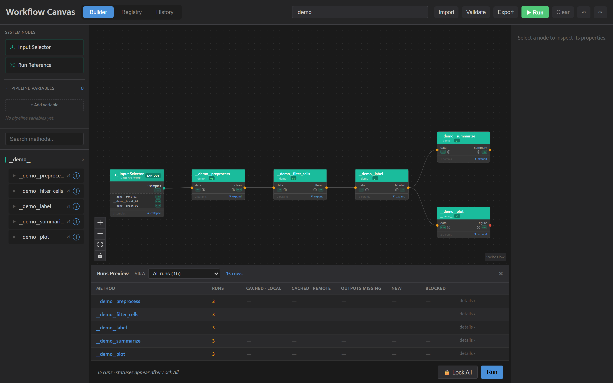
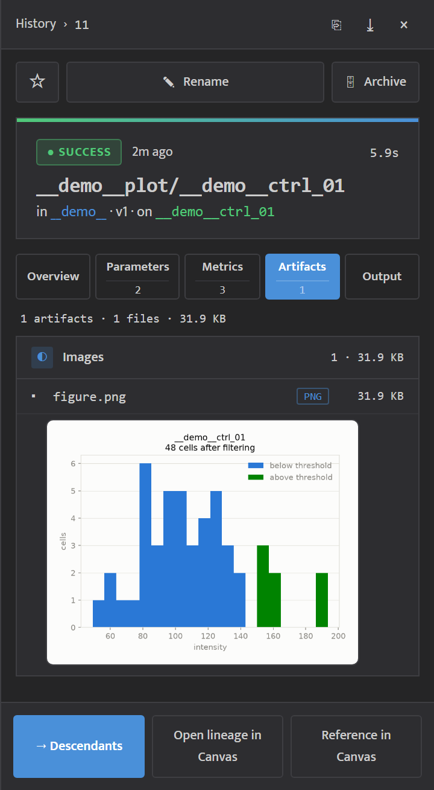
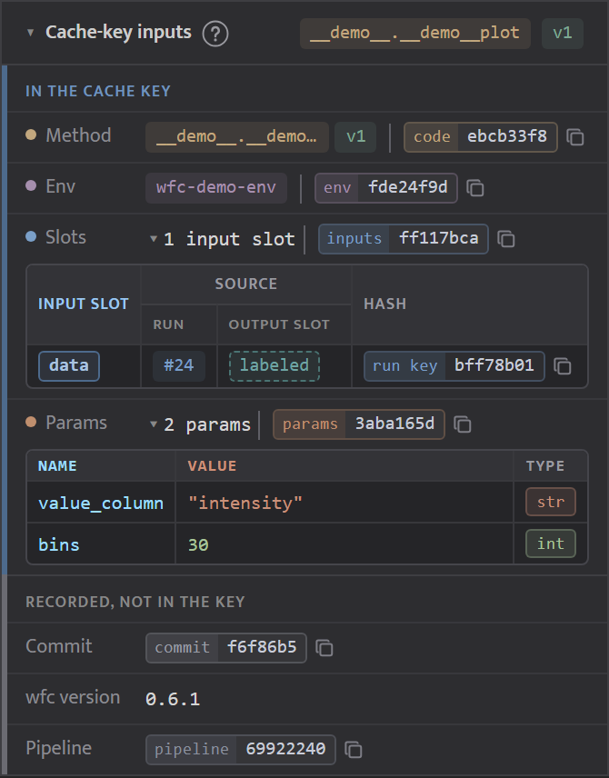

<!-- generated from pm_mvp::docs/consumer/tutorials/wfc-demo @ 42c6b5136637; do not edit -->

# Tutorial: Exploring the Demo

## What `wfc demo` does

`wfc demo` adds a complete, runnable pipeline to a project and opens it in the Canvas, so you can watch a run end to end before writing any methods of your own. It needs the same prerequisites as [Getting Started](getting-started.md#prerequisites): Python, Docker running, and git.

```bash
pip install workflow-canvas
wfc init --dir demo_project --yes
cd demo_project
wfc demo
```

`wfc demo` works in an existing project, so run `wfc init` first. It then:

- builds a small container image for the demo, a packaged copy of the software and dependencies its methods need ([The Tools Behind Workflow Canvas](../explanation/how-the-pieces-fit-together.md)) (the first build takes a few minutes) and registers it as the environment `wfc-demo-env`. The image stays on this machine, even when the project has a registry; the output names `wfc push-env wfc-demo-env` for when you want to share it ([Share the demo](#share-the-demo));
- registers the module `__demo__` with five methods, and three samples;
- writes the pipeline to `demo-pipeline.json`;
- starts the Canvas at `http://127.0.0.1:8500/?pipeline=demo` and opens it in your browser with the pipeline loaded.

Press **Run** to run all five steps for all three samples.



The Canvas keeps running until you press Ctrl+C in the terminal. To come back to it later, run `wfc canvas` and open `http://127.0.0.1:8500/?pipeline=demo`. Both `wfc demo` and `wfc canvas` take `--port` to serve on another port, and `wfc demo --no-open` sets up the demo without opening the browser.

If the demo is already in the project, `wfc demo` stops and tells you to pass `--force` or to remove it with `wfc demo --remove`. `wfc demo --force` removes the existing demo, its runs included, and builds it again.

A demo made by an older wfc is refused the same way ("made by an older wfc; run `wfc demo --force`"), and `wfc doctor` warns about it under its **Env images** table. After upgrading wfc, run `wfc demo --force` once to bring the demo up to date.


## The Pipeline

Every name the demo registers starts with `__demo__`: the methods are `__demo__preprocess`, `__demo__filter_cells` and so on, and the samples are `__demo__ctrl_01`, `__demo__treat_01` and `__demo__treat_02`. This page uses the short names.

The pipeline runs five methods on each sample:

```
preprocess -> filter_cells -> label -> summarize
                                    -> plot
```

- **preprocess** drops rows with no `intensity` value.
- **filter_cells** keeps rows with `quality` at or above `min_quality` (0.5).
- **label** adds a `label` column: `above` or `below`, depending on whether `intensity` reaches `threshold` (150).
- **summarize** reports the row count and mean intensity for each label.
- **plot** draws an intensity histogram for the sample, coloured by label.

The method scripts are copied into your project under `.wfc/registry/methods/__demo__/<name>/`. Each one has comments that match its code to its `method.yaml` (each input, parameter and output), so you can use them as a starting point for your own methods. See [Writing a Method in Python](authoring-a-method-script.md).


## Inspecting a Run

When the run finishes, open the **History** tab and select a `plot` run. Its **Artifacts** tab shows the histogram as a thumbnail; click it to see it full size. See [Build, Run and Inspect in the Canvas](../how-to/canvas.md) for everything the run detail panel shows.



On the run's **Overview** tab, open the **Cache-key inputs** card at the bottom. It lists what wfc compared to decide whether it could reuse the run: the method and its code, the environment, each input slot and the run or sample that filled it, and the params. Change one of the `plot` step's params, run the pipeline again and open the new `plot` run: in the cache key, only its `params` hash differs from the earlier run's, which is why that step ran again while the steps above it were reused. Its `pipeline` hash differs too, because you edited the pipeline, but that one is recorded only and never decides a re-run.



To copy any step's output out of wfc, use the run ID shown in the detail panel:

```bash
wfc export --run <run-id>                                  # list the run's outputs
wfc export --run <run-id> --slot <output-name> --dest <dest>   # copy one output to <dest>
```


## The Sample Data

Each sample is a CSV of 50 cells with the columns `id`, `intensity`, `area` and `quality`. One or two cells per file have no `intensity`, which is what `preprocess` removes.

| Sample | intensity range | quality range |
|---|---|---|
| `ctrl_01` | 49.2 – 193.5 | 0.51 – 0.98 |
| `treat_01` | 70.3 – 272.2 | 0.31 – 0.95 |
| `treat_02` | 80.0 – 320.7 | 0.21 – 0.80 |

With the default parameters, most control cells are labelled `below` and most treated cells `above`. Try changing the parameters on the Canvas and running again:

- Raise `threshold` to 200 and every `ctrl_01` cell falls `below`.
- Change `min_quality` and the row count of `treat_02`, which has the most low-quality cells, changes the most.

Steps whose inputs and parameters did not change are reused from the earlier run instead of running again.


## Export a run and rerun it

Any run can leave wfc as one zip that holds everything that made it: the samples it read, each step's code, parameters and container image, and how each step was launched. Whoever receives it reruns it with Python and Docker, without installing wfc, and sees for each output whether it came out the same.

1. **Export a `plot` run.** In the History tab, open the `plot` run for `ctrl_01` and click **Export run** in the detail panel's header. Turn on **Include outputs** and **Include images**, then click **Export**. The dialog shows that the bundle holds four steps: `plot` and the three steps above it. From the command line, take the run ID from the detail panel, or find it with `wfc runs --method __demo__.__demo__plot`:

   ```bash
   wfc export-run --run <run-id> --out demo-plot.zip --with-outputs --with-image
   ```

   The demo's image is only on this machine, so **Include images** saves it into the zip (about 100 MB), and the zip needs nothing else.

2. **Rerun it.** Unzip it into a new folder, on this computer or on another one with Python 3.11 or newer and Docker, and run:

   ```bash
   python rerun.py
   ```

   After a line about the image, it prints one line per output:

   ```text
   Step 1  run 2   __demo__.__demo__preprocess v1    __demo__ctrl_01   clean.csv     same
   Step 2  run 4   __demo__.__demo__filter_cells v1  __demo__ctrl_01   filtered.csv  same
   Step 3  run 7   __demo__.__demo__label v1         __demo__ctrl_01   labeled.csv   same
   Step 4  run 12  __demo__.__demo__plot v1          __demo__ctrl_01   figure.png    same
   All 4 outputs are the same.
   ```

3. **Look inside.** The bundle's `README.md` lists each step with its method version, sample, image, parameters and output hashes. Each step's folder under `steps/` holds its code, the exact `docker run` it ran, and its logs.

The same zip works whether you send it to a collaborator, attach it to a paper or keep it with a finished project. [Share runs as a bundle anyone can rerun](../how-to/run-and-inspect-results.md#share-runs-as-a-bundle-anyone-can-rerun) covers the options, what the receiver needs, and what to do when an output comes out `DIFFERENT`.

## Share the demo

Exporting a run sends a result. Sharing the project gives a collaborator its methods, environments and samples, so they can build and run pipelines of their own. The demo is a small project to learn this on before you do it with your own: going through the steps here shows what each one does and what `wfc share` reports. The full procedure is in [Share a Project](../how-to/sharing-a-project.md).

`wfc demo` keeps the demo's image on this machine. To share the project, give it a registry, push the image, then check what a collaborator would still miss.

1. **Push the image.** The first `wfc push-env` in a project sets its registry. With a GitHub remote it proposes `ghcr.io/<owner>/<repo>` and shows what it will push; after you confirm, it saves the registry in `.wfc/wf-canvas.toml`. Without a GitHub remote, or to use another registry, pass `--registry <base>`. Docker must be logged in to the registry first; `wfc share` prints the `docker login` line.

   ```bash
   wfc push-env wfc-demo-env      # or: wfc push-env --all
   ```

2. **Check the result.** `wfc share` prints one row per check and changes nothing:

   ```bash
   wfc share
   ```

   Each row that warns names the command that fixes it. Fix the rows in order and run `wfc share` again. The packages row asks GitHub through your `gh` login; if that login lacks the packages permission, the row says so and gives the command that adds it (`gh auth refresh --hostname github.com --scopes write:packages`).

3. **See the image on GitHub.** Open your GitHub profile's **Packages** tab: the demo's environment is the package `<repo>/wfc-demo-env`, tagged `fp-` and the first 12 characters of its fingerprint. The repository's main page lists it under **Packages**. [See Your Images on GitHub](../how-to/see-your-images-on-github.md) explains each page.

## Removing the Demo

```bash
wfc demo --remove
```

This lists what it will delete and asks you to confirm; pass `--yes` to skip the question. It removes the demo's module, methods, samples, environment (with its `.wfc/captures/` folder) and runs, the demo's registered copies under `.wfc/registry/methods/__demo__/`, `demo-pipeline.json` and the demo's `.wfc/demo.json` file. The environment is found through the demo's methods, so a demo made by an older wfc is removed with its own environment. It also removes the folders the demo's samples were restored into, and says so if it cannot remove one. Add `--purge-image` to also delete the demo's Docker image. Cached output files stay in the cache until you run `wfc cache prune`.

Nothing you register yourself is removed: wfc refuses any module, method or sample name that starts with `__demo__`, and the environment name `wfc-demo-env`, so only the demo carries them.

## Next Steps

To build a pipeline of your own, follow [Getting Started](getting-started.md), then [Writing a Method in Python](authoring-a-method-script.md). The demo's scripts under `.wfc/registry/methods/__demo__/<name>/` are a second set of worked examples; copy them before you remove the demo.

